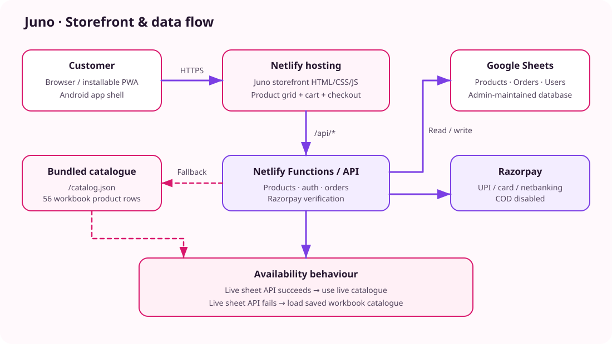
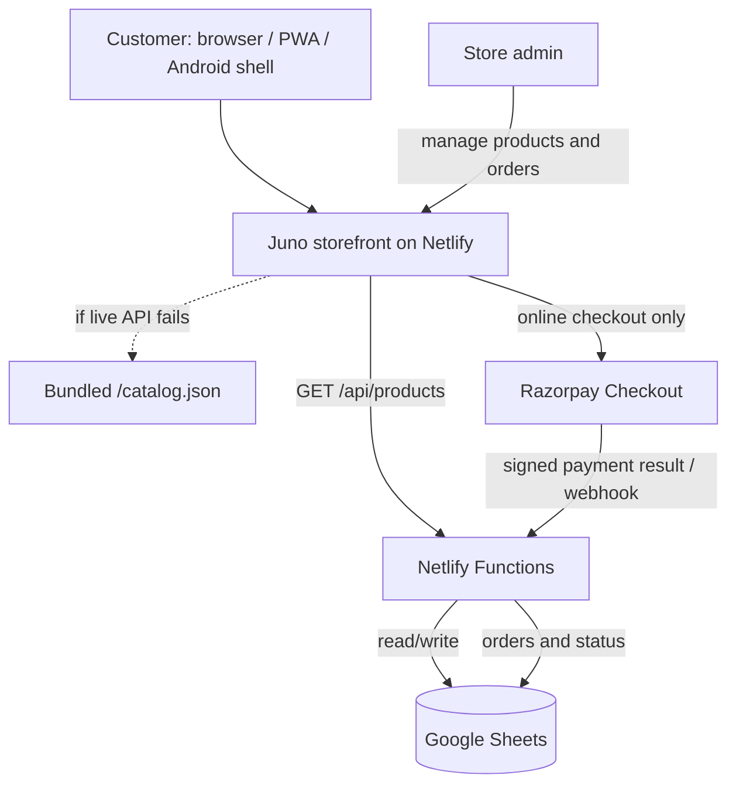
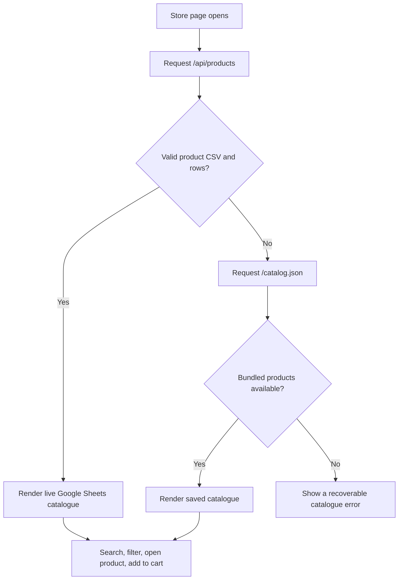
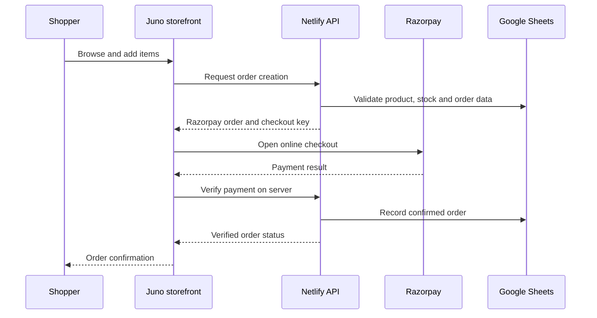

# Juno — Budget Fashion Store

Juno is a budget-fashion storefront for women, men and kids, with accessories, a responsive web experience, an installable PWA, an Android shell, a Netlify serverless API, Google Sheets data storage and Razorpay online checkout.

> **Catalogue recovery:** the storefront now includes a bundled catalogue generated from the supplied `Threadly_Database.xlsx` workbook. It contains **56 product rows across 14 categories**. The website tries the live Google Sheets-backed API first and falls back to this bundled catalogue if the API is unavailable, so a temporary backend/configuration failure should no longer leave the product grid empty.
>
> **Data accuracy note:** the supplied workbook's “How to use” tab describes its rows as samples. The rows have been copied as provided; verify product names, prices and stock before accepting real orders. The workbook contains no product image URLs, so the storefront uses its built-in category illustrations until images are added.

## Contents

- [Architecture](#architecture)
- [Catalogue and data flow](#catalogue-and-data-flow)
- [Repository layout](#repository-layout)
- [Run locally](#run-locally)
- [Netlify configuration](#netlify-configuration)
- [Google Sheets setup](#google-sheets-setup)
- [Online payments](#online-payments)
- [Admin and customer flows](#admin-and-customer-flows)
- [Validation checklist](#validation-checklist)
- [Troubleshooting](#troubleshooting)
- [Security and production notes](#security-and-production-notes)

## Architecture





### Main components

| Component | Location | Responsibility |
|---|---|---|
| Storefront | `threadly-v2/public/index.html` | Homepage, search, category filters, product cards, cart, customer account and checkout UI |
| Bundled product snapshot | `threadly-v2/public/catalog.json` | Offline-from-backend fallback catalogue sourced from the supplied workbook |
| Netlify configuration | `netlify.toml` | Sets the site base, publish directory, functions directory and API rewrites |
| Serverless functions | `threadly-v2/netlify/functions/` | HTTP endpoints for products, authentication, orders, payments and SEO |
| Shared backend logic | `threadly-v2/netlify/lib/core.js` | Business rules, validation, authentication and Razorpay integration |
| Sheets client | `threadly-v2/netlify/lib/sheets.js` | Google Sheets API access |
| Android wrapper | `threadly-android/` | Capacitor Android app shell that loads the deployed website |
| Android CI | `.github/workflows/build-threadly-android.yml` | Builds a test APK on GitHub Actions |
| Storefront validation | `.github/workflows/` | Automated checks on storefront changes |

## Catalogue and data flow

The current product snapshot contains 56 rows from the supplied workbook: Dresses, Tops, Ethnic, Footwear, Menswear, Kidswear, Wallets, Hair Clips, Scrunchies, Hair Bands, Sunglasses, Watches, Earrings and Bags.



- **Live mode:** products and stock come from the configured Google Sheet when the API is healthy.
- **Fallback mode:** `catalog.json` allows browsing when the live API cannot respond. This is a saved snapshot; it does not automatically receive new sheet edits.
- **Images:** image cells in the provided workbook were empty. Add product image URLs in the database to replace category illustrations with real photos.
- **Ratings and reviews:** product ratings are carried over from the workbook. Review count is set to zero because the workbook does not provide review-count data.
- **Inventory:** the supplied stock values are copied exactly; because the workbook labels these rows as samples, verify them before taking paid orders.

### Keeping website and app in sync

The Android shell opens the deployed Juno site rather than maintaining a separate product database. Once the live API and Google Sheet are configured, website and app users can see the same live catalogue. The bundled JSON is a resilience fallback, not a replacement for the shared database.

## Repository layout

```text
.
├── README.md
├── netlify.toml
├── docs/
│   └── juno-architecture.svg
├── .github/workflows/
│   ├── build-threadly-android.yml
│   └── storefront validation workflow(s)
├── threadly-v2/
│   ├── public/
│   │   ├── index.html
│   │   ├── catalog.json
│   │   ├── manifest.webmanifest
│   │   └── ...
│   ├── netlify/
│   │   ├── functions/
│   │   └── lib/
│   └── README.md
└── threadly-android/
    ├── capacitor.config.json
    └── ...
```

## Run locally

Prerequisites: Node.js LTS, npm, and (for a full backend test) a Netlify CLI installation.

1. Clone the repository and enter the website folder:
   ```bash
   git clone https://github.com/jananisr2020/Threadly.git
   cd Threadly/threadly-v2
   npm install
   ```
2. Run the repository's validation script if available:
   ```bash
   npm run check
   ```
3. To run the site with Netlify Functions locally, configure the environment variables below and use the Netlify CLI:
   ```bash
   npx netlify dev
   ```
4. Open the local URL printed by the CLI. Without valid Google Sheets credentials, the storefront should still load its bundled product catalogue.

> Never add `.env` files, service-account JSON files, private keys, Razorpay secrets or administrator passwords to Git.

## Netlify configuration

The repository root `netlify.toml` sets:

- **Base directory:** `threadly-v2`
- **Publish directory:** `public`
- **Functions directory:** `netlify/functions`
- **API rewrite:** `/api/*` → Netlify Functions
- **SEO rewrites:** `/sitemap.xml` and `/robots.txt`

In Netlify, connect the existing GitHub repository `jananisr2020/Threadly` on branch `main`. Keep the committed build settings; do not configure the repository root as the publish directory. After a push, open **Deploys** and verify the deploy has completed successfully before testing the live domain.

## Google Sheets setup

The workbook supplied to the project has these tabs: `Products`, `Orders`, `Users`, `Summary` and `How to use`. The backend also uses supporting tabs for pending payment reconciliation, reviews, requests and support tickets; create any missing tabs with the headers documented in `threadly-v2/README.md`.

1. Import `Threadly_Database.xlsx` into Google Sheets as a new spreadsheet.
2. Preserve the `Products`, `Orders` and `Users` tab names and the first-row headers expected by the code.
3. Enable the Google Sheets API in Google Cloud.
4. Create a service account and a JSON key. Store its email and private key in Netlify environment variables.
5. Share the spreadsheet with the service-account email as **Editor**.
6. Copy the spreadsheet ID from its URL into `SHEET_ID`.
7. Deploy again and test `/api/products`. It should return product CSV, not an error object or HTML page.

### Environment variables

Set these under **Netlify → Site configuration → Environment variables**. Use private values from your own accounts; never commit secrets.

| Variable | Purpose |
|---|---|
| `SHEET_ID` | Google spreadsheet ID |
| `GOOGLE_SERVICE_ACCOUNT_EMAIL` | Google service-account email |
| `GOOGLE_PRIVATE_KEY` | Service-account private key, including PEM boundaries |
| `JWT_SECRET` | Secret used to sign authentication tokens |
| `ADMIN_PASSWORD` | Admin login password or configured admin credential |
| `RAZORPAY_KEY_ID` | Razorpay API key ID |
| `RAZORPAY_KEY_SECRET` | Razorpay API secret |
| `RAZORPAY_WEBHOOK_SECRET` | Secret used to verify webhook signatures |
| `BREVO_API_KEY` | Optional transactional email integration |
| `MAIL_FROM` | Verified sender address for transactional email |

After changing environment variables, trigger a fresh Netlify deploy. Check the function logs for authentication, missing-tab, permission and spreadsheet-ID errors.

## Online payments

- Cash on delivery is disabled in the storefront and backend.
- The supported checkout methods are online payment options exposed by the Razorpay checkout integration.
- Use Razorpay **Test Mode** keys to validate the order lifecycle before switching to approved live keys.
- Configure the webhook endpoint to match the deployed site's Razorpay webhook function and use the same webhook secret in Razorpay and Netlify.
- Test successful payment, failed payment, cancelled checkout and duplicate webhook delivery. Confirm that an order is not marked paid until server-side verification succeeds.

Do not test live payments using unverified catalogue prices or stock.

## Admin and customer flows



Admin access, product management, order management and customer account behaviour depend on the backend environment variables and Google Sheet permissions being correct. Do not expose admin credentials in client-side code.

## Validation checklist

- [ ] The homepage displays products even if `/api/products` is unavailable.
- [ ] Product count, names, categories, prices and stock match the bundled database snapshot.
- [ ] Search, category filtering, product detail and cart quantity controls work.
- [ ] Out-of-stock items cannot be purchased.
- [ ] Checkout has no cash-on-delivery option.
- [ ] Server-side product, price and stock validation is active before creating an order.
- [ ] Razorpay payment verification succeeds in Test Mode.
- [ ] Confirmed orders are written to the Google Sheet.
- [ ] Netlify deploy is green and the live domain is serving the latest commit.
- [ ] The product API works after the Google Sheet is shared with the service account.
- [ ] Add real product images and verify sample workbook values before launch.

## Troubleshooting

| Symptom | What to check |
|---|---|
| Product grid is empty | Open browser dev tools; check `/catalog.json` and `/api/products`. If the bundled file is unavailable, inspect the Netlify publish directory and latest deploy. |
| Saved catalogue appears but live updates do not | Fix `SHEET_ID`, service-account email/private key, Google Sheets API enablement, sharing permissions and tab headers. The fallback is a snapshot. |
| API returns an error object instead of CSV | Inspect Netlify Function logs and the backend environment variables. The storefront falls back to the bundled catalogue. |
| Payment window does not open | Verify Razorpay key ID, network access, Test/Live mode alignment and function logs. |
| Order is not recorded | Verify server-side payment signature checks, webhook URL/secret, Google Sheet permissions and required tabs. |
| Netlify still shows an older page | Confirm the correct repository and `main` branch are linked, then inspect the latest production deploy commit. |

## Security and production notes

- Keep all private credentials in Netlify environment variables.
- Do not commit customer information, passwords, tokens, service-account JSON or payment secrets.
- Treat the workbook's catalogue values as starter data until reviewed by the store owner.
- The bundled catalogue is intentionally public and should contain only public product data.
- A successful GitHub Actions check confirms the code check/build only; it does not prove that Netlify environment variables, Google Sheets permissions or live payment configuration are correct.
